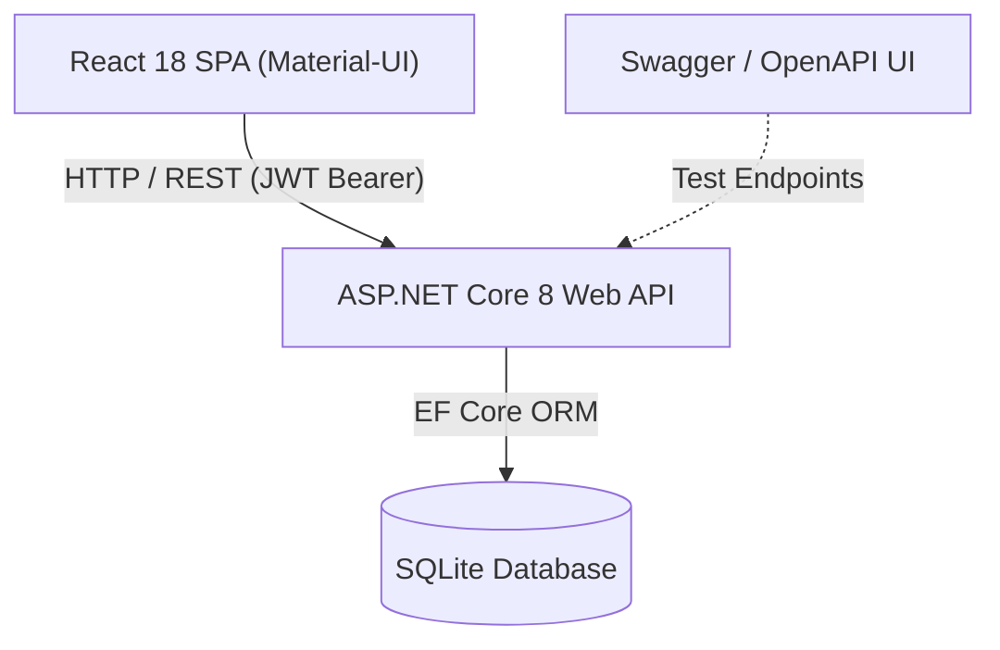

# Wordle Arena | Full-Stack Worlde Clone

[](https://react.dev/)
[](https://mui.com/)
[](https://dotnet.microsoft.com/)
[](https://www.sqlite.org/)
[](https://jwt.io/)

A full-stack, competitive Wordle web application featuring real-time input handling, guess evaluation algorithms, stateless JWT-based authentication, and a global leaderboard powered by an ASP.NET Core Web API with an embedded SQLite database. It was first developed as an highschool project but as I got older I wanted to improve on it since I couldn't finish it in the 12th grade.

---

## Key Features

* **Authentic Wordle Experience**:
  * 6-guess letter evaluation with duplicate letter handling (Green = correct position, Yellow = wrong position, Dark Gray = absent).
  * Dual-input support: interactive on-screen virtual keyboard and desktop physical keyboard events.
  * Shake animations for short words or invalid vocabulary entries.
* **Global Competitive Leaderboard**:
  * Real-time score ranking, win rates, and active streak multipliers.
  * Efficiency-based scoring formula: rewards quick solutions (fewer attempts) and continuous winning streaks.
* **Secure Authentication & User Profiles**:
  * Token-based authentication using **JSON Web Tokens (JWT)**.
  * One-way password hashing using **BCrypt** with salt and work factor.
  * Guest play allowed, with seamless prompt to link scores to an account.
* **Easy to port Database**:
  * Embedded **SQLite** via Entity Framework Core: creates tables and initial seed data automatically on launch without external database dependencies. Initially it was developed in Visual Studio so I fixed this now.
* **Interactive API Documentation**:
  * Built-in **Swagger / OpenAPI** explorer with Bearer token authorization support.

---

## Architecture & Tech Stack



### Frontend (`myuserinttest/`)
* **Framework**: React 18
* **UI Components**: Material UI (MUI v5)
* **Routing**: React Router v6
* **State Management**: React Context API (`AuthContext`)

### Backend (`BackendLeaderboard/`)
* **Framework**: ASP.NET Core 8 Web API
* **ORM**: Entity Framework Core 8 (SQLite provider)
* **Authentication**: JWT Bearer Tokens (`Microsoft.AspNetCore.Authentication.JwtBearer`)
* **Password Hashing**: BCrypt.Net-Next
* **Documentation**: Swashbuckle (Swagger UI)

---

## How to launch it after cloning

### Prerequisites
* [Node.js](https://nodejs.org/) (v18+) & `npm`
* [.NET 8 SDK](https://dotnet.microsoft.com/download/dotnet/8.0)

### 1. Launch the Backend API
```bash
cd BackendLeaderboard
dotnet run
```
* **API Base URL**: `http://localhost:5057`
* **Swagger Documentation**: `http://localhost:5057/swagger`

*(The SQLite database `leaderboard.db` and sample leaderboard data are generated automatically on first startup).*

### 2. Launch the Frontend
```bash
cd myuserinttest
npm install
npm start
```
* The application will open at **`http://localhost:3000`**.

---

##  API Endpoints Overview

| Method | Endpoint | Description | Auth Required |
|---|---|---|---|
| `POST` | `/api/auth/register` | Register a new user and receive JWT token | No |
| `POST` | `/api/auth/login` | Authenticate existing user | No |
| `GET` | `/api/auth/me` | Fetch authenticated user stats & profile | **Yes (Bearer JWT)** |
| `GET` | `/api/leaderboard` | Get ranked leaderboard (top 50 players) | No |
| `POST` | `/api/leaderboard/score` | Submit game result and update stats/streak | **Yes (Bearer JWT)** |

---

##  Scoring System

Points are awarded dynamically based on how quickly the word is discovered:
* **1 Guess**: 100 points
* **2 Guesses**: 80 points
* **3 Guesses**: 60 points
* **4 Guesses**: 45 points
* **5 Guesses**: 30 points
* **6 Guesses**: 20 points
* **Streak Bonus**: `+5` points per consecutive win (capped at +50 bonus points).
* **Defeat**: Streak resets to 0.
